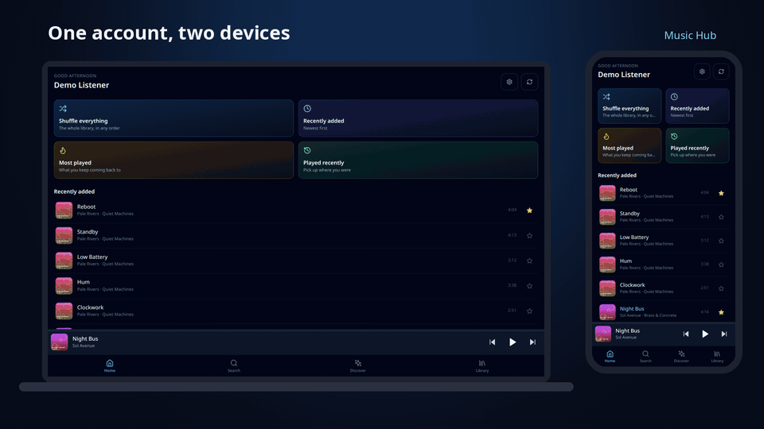
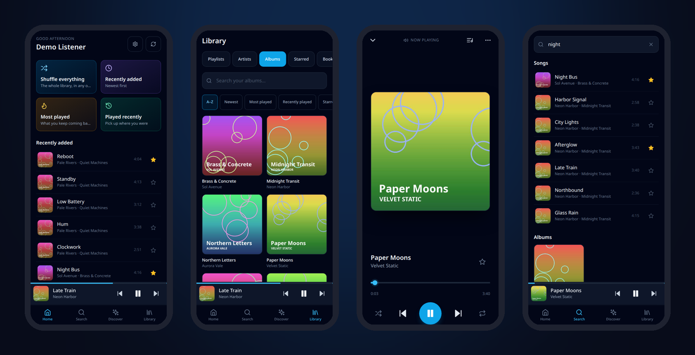

<div align="center">

# 🎧 Music Hub

**Your music, on every device, from your own server.**

A self-hosted music server with a fast mobile-first web app and an Android app.
Start a song on your laptop, skip it from your phone, then move the sound to the
phone with one tap — every device signed in to your account shares one queue.

[](https://github.com/y0c0ms/Music-Hub/releases/latest)
[](LICENSE)

[**Quick start**](#-try-it-in-two-minutes) · [**Android app**](https://github.com/y0c0ms/Music-Hub/releases/latest) · [**Features**](#-features) · [**Security**](SECURITY.md)



<sub>Real recording of the released image, with an invented demo library. [MP4 version](docs/media/demo.mp4).</sub>

</div>

## ✨ Features

### Play anywhere, control from anywhere
- **One queue across all your devices.** Phone, laptop, tablet, the Android app — they all see the same queue, position and current song, live.
- **Pick where the sound comes from.** Any device can be the speaker; the others become remotes. Moving playback keeps the song and the position.
- **Offline.** Save songs, albums and playlists to a device and play them with no connection.
- **Installable.** Add the web app to your home screen, or use the Android app with background playback and lock-screen controls.

### Your library, organised
- **Albums, artists, genres, playlists, favourites** and play counts, built from your own files' tags and artwork.
- **Search that forgives** accents, typos and partial words.
- **Shared and personal libraries** — each user has a private downloads folder next to the shared collection.
- **Audiobooks** with chapters and per-user progress, on their own shelf, never mixed into music.

### Grow it
- **Download** tracks or whole albums from YouTube with yt-dlp — tagged, with cover art, deduplicated against what you already own.
- **New releases** from the artists you listen to, and a swipe deck of suggestions with 30-second previews (ListenBrainz / Last.fm).
- **Scrobbling** to ListenBrainz.

<div align="center">



</div>

### Built to be trusted
- **Single sign-on** through any OpenID Connect provider (Keycloak, Authentik, Authelia, Zitadel…). Tokens never reach the browser; sessions are stored hashed.
- **One small Rust binary** with the web app embedded, PostgreSQL for everything else.
- **Every release is gated:** tests on a real database, a coverage floor, `clippy -D warnings`, `cargo audit`, `npm audit`, secret scanning, semgrep, and a container CVE scan with **zero fixable high/critical findings** on the exact image that is published. The gates run on the maintainer's own CI (Forgejo Actions, workflows in [`.forgejo/workflows`](.forgejo/workflows)); a release is pushed here only after they pass.

## 🚀 Try it in two minutes

You need Docker and an OpenID Connect provider. Save this as `compose.yaml`,
fill in the three `OIDC_`/`PUBLIC_URL` values, and run `docker compose up -d`:

```yaml
services:
  db:
    image: pgvector/pgvector:pg18
    environment:
      POSTGRES_USER: musichub
      POSTGRES_PASSWORD: change-me
      POSTGRES_DB: musichub
    volumes: [db:/var/lib/postgresql]   # Postgres 18 keeps its data under this directory
    restart: unless-stopped

  music-hub:
    image: ghcr.io/y0c0ms/music-hub:latest
    depends_on: [db]
    ports: ["8080:8080"]
    environment:
      PUBLIC_URL: https://music.example.com          # where you will open it
      OIDC_ISSUER: https://auth.example.com/realms/example
      OIDC_CLIENT_ID: music-hub
      OIDC_CLIENT_SECRET: change-me
      DATABASE_URL: postgres://musichub:change-me@db:5432/musichub
    volumes:
      - /path/to/your/music:/music
      - state:/state
    restart: unless-stopped

volumes: {db: {}, state: {}}
```

Register `<PUBLIC_URL>/auth/callback` as the redirect URI of the OIDC client,
open `PUBLIC_URL` and sign in. The library is indexed in the background at
startup; songs appear as soon as it finishes. On Android, install the APK from the
[latest release](https://github.com/y0c0ms/Music-Hub/releases/latest) and
enter the same address on first launch.

Check the APK you downloaded against the release's `SHA256SUMS`:

```bash
sha256sum -c SHA256SUMS
```

## Requirements

- **PostgreSQL 18** with the **pgvector** extension available
  (e.g. the `pgvector/pgvector:pg18` image). Migrations run automatically at
  startup and create the `vector`, `unaccent` and `pg_trgm` extensions, so the
  database role needs permission to create them (or create them beforehand).
- An **OpenID Connect provider** (Keycloak, Authentik, Authelia, Zitadel, ...)
  with a confidential client.
- A music folder, mounted read-write (downloads are written into it).

The container image already contains ffmpeg, yt-dlp and mutagen.

## Running with `docker run`

```bash
docker run -d --name music-hub -p 8080:8080 \
  -e PUBLIC_URL=https://music.example.com \
  -e DATABASE_URL=postgres://musichub:secret@db:5432/musichub \
  -e OIDC_ISSUER=https://auth.example.com/realms/example \
  -e OIDC_CLIENT_ID=music-hub \
  -e OIDC_CLIENT_SECRET=change-me \
  -v /srv/music:/music \
  -v music-hub-state:/state \
  ghcr.io/y0c0ms/music-hub:latest
```

Put it behind an HTTPS reverse proxy that serves `PUBLIC_URL`. If that proxy is
nginx, keep response buffering off for `/api/playback/stream` (the server sends
`X-Accel-Buffering: no`, which nginx honours).

The container runs as UID 1000; the music folder and `/state` must be writable
by it. Health check: `GET /healthz`.

## Configuration

All configuration is read from environment variables at startup
(`crates/core/src/config.rs`). Empty counts as unset.

| Variable | Default | Purpose |
|---|---|---|
| `OIDC_ISSUER` | **required** | OIDC issuer URL; discovery is fetched from `<issuer>/.well-known/openid-configuration`. |
| `OIDC_CLIENT_SECRET` | **required** | Secret of the confidential OIDC client. Never sent to the browser. |
| `DATABASE_URL` | **required** | PostgreSQL connection string. |
| `PUBLIC_URL` | `http://localhost:8080` | External URL of the app. The OIDC redirect URI is `<PUBLIC_URL>/auth/callback`; an `https://` URL also marks cookies `Secure`. |
| `OIDC_CLIENT_ID` | `music-hub` | OIDC client ID. |
| `PORT` | `8080` | Listen port. |
| `MUSIC_ROOT` | `/music` | Library root inside the container. |
| `REQUESTS_DIR` | `requests` | Where acquired tracks land, relative to `MUSIC_ROOT`. |
| `DISCOVERY_PREFIX` | `explo/` | The only library-relative prefix a discovery dislike may delete from. |
| `BOOKS_PREFIX` | `books/` | Folder (relative to `MUSIC_ROOT`) whose files are audiobooks. |
| `STATE_DIR` | `/state` | Server state (cover cache, job state). Keep it persistent. |
| `CACHE_DIR` | `/tmp/previews` | Disposable preview-clip cache. |
| `SERVICE_TOKEN` | *(empty)* | Bearer token for `/api/internal/*` (scan, retag, owned). Empty disables those routes. |
| `LISTENBRAINZ_USER` | *(empty)* | Server-wide ListenBrainz account used when a user has not linked their own. |
| `LISTENBRAINZ_USERS` | *(empty)* | Per-user overrides: `oidcUser:lbUser,other:lbUser2`. |
| `LASTFM_API_KEY` | *(empty)* | Enables Last.fm discovery suggestions and genre enrichment. |
| `NTFY_URL` | *(empty)* | ntfy server for operational alerts; empty disables alerting. |
| `NTFY_TOPIC` | `music-hub` | ntfy topic. |
| `NTFY_TOKEN` | *(empty)* | ntfy access token. |
| `SSL_CERT_FILE` | *(unset)* | PEM file or bundle of **extra** CAs to trust for outbound HTTPS (OIDC provider, ntfy, proxies). Added to the built-in public roots, not a replacement. |
| `RUST_LOG` | `info` | Log filter. |

### OIDC

Create a confidential client in your provider:

- Redirect URI: `<PUBLIC_URL>/auth/callback`
- Scopes: `openid profile email`
- The ID token must carry `preferred_username`; it becomes the Music Hub user
  name (lower-cased for library ownership). `name` is used as the display name
  when present.

If the provider's certificate is signed by a private CA, mount the CA and set
`SSL_CERT_FILE` to it — the server does not read the system trust store.

## Building from source

Rust 1.94 (pinned in `rust-toolchain.toml`) and Node.js 22. The web app is
embedded into the binary at compile time, so build it first:

```bash
cd web && npm ci && npm run build && cd ..
cargo build --release -p music-hub
# -> target/release/music-hub
```

Or build the image:

```bash
docker build -t music-hub .
```

Tests: `cargo test --workspace` (database tests run only when `DATABASE_URL`
points at a scratch Postgres) and `cd web && node mock/saved.test.mjs`.

For UI work without a backend, `node web/mock/server.mjs` serves a mock API on
port 8080 for `npm run dev`.

### Importing from Navidrome

`mh-migrate <navidrome.db> [--commit]` imports playlists, stars and play counts
from a Navidrome SQLite database into `DATABASE_URL`. It is a dry run unless
`--commit` is given; users must have signed in once first.

## Android app

Download the APK from
[GitHub Releases](https://github.com/y0c0ms/Music-Hub/releases). On first launch
it asks for your server's `https://` URL. See
[android-shell/README.md](android-shell/README.md) for building it yourself and
for servers behind a private CA.

## 🤝 Contributing

Issues and pull requests are welcome — see [CONTRIBUTING.md](CONTRIBUTING.md)
and the [Code of Conduct](CODE_OF_CONDUCT.md). Questions and ideas go to
[Discussions](https://github.com/y0c0ms/Music-Hub/discussions). Found a
security problem? Please report it [privately](SECURITY.md).

If Music Hub is useful to you, a ⭐ helps other people find it.

## License

[MIT](LICENSE)
